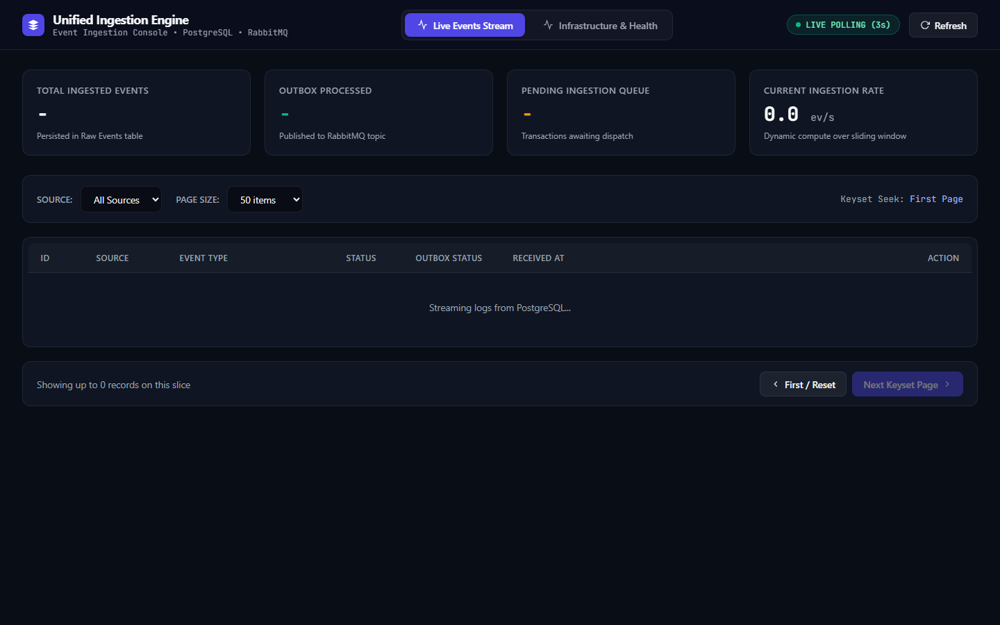

# Ingestly


A reliable, fault-tolerant webhook & event ingestion service built with **FastAPI**, **RabbitMQ**, **PostgreSQL**, and **Docker**.

Ingestly acknowledges incoming webhooks with low latency (`~60 ms` p50 unloaded, `202 Accepted`), persists events atomically with a **Transactional Outbox**, enforces two-tier idempotency, handles transient failures via **multi-tier TTL retry queues** (`5s -> 30s -> 5m`), routes poisoned messages to a Dead-Letter Queue (DLQ), and exposes authenticated query, replay, retention, and observability APIs.

**Delivery guarantee:** At-least-once delivery; duplicates are absorbed by two-tier idempotency (not exactly-once).

---

## Architecture Overview

```text
[ External Producer / GitHub Webhook ]
                   |
                   v
           [ FastAPI Ingress ]  <-- Streaming size cap, Rate Limiter, HMAC-SHA256 + Timestamp check, Correlation ID
             /           \
(Atomic Transaction)    (Immediate Publish)
           v               v
[ Postgres: raw_events ]  [ RabbitMQ: events.inbound ]
[ Postgres: outbox     ]          |
      |                           v
(Outbox Reconciler:       [ Worker Consumer ] (Prefetch: 50, Concurrency: 25, SIGTERM drain)
 SELECT ... FOR UPDATE            |
 SKIP LOCKED)                     +-----------------------+
      |                           | (Success)             | (Transient Error)
      +-------------------------> v                       v
                            [ Postgres ]          [ RabbitMQ: events.retry.{5s,30s,5m} ]
                          (processed_events)              | (Dead-letters back after TTL)
                                                          v
                                                  [ RabbitMQ: events.inbound ]
                                                          | (Max retries / Permanent Error)
                                                          v
                                                  [ RabbitMQ: events.dlq ]
                                                  [ Postgres: failed_events ]
                                                          ^
                                                          |
                                                  [ POST /replay API ] (Atomic via Outbox, X-API-Key)
```

---

## Operations Dashboard



Authenticated via HTTP Basic Auth (any username, `REPLAY_API_KEY` as password) or `X-API-Key` / `Bearer` header at `http://localhost:8000/dashboard`.

---

## Tech Stack

- **Ingress API:** FastAPI, Uvicorn (async HTTP)
- **Message Broker:** RabbitMQ 3.13 (AMQP 0-9-1 with persistent queues, publisher confirms, and DLX)
- **AMQP Client:** `aio-pika` (async RabbitMQ client)
- **Database & Migrations:** PostgreSQL 16 (async via SQLAlchemy 2.0 & `asyncpg`), Alembic
- **Testing:** Pytest, `pytest-asyncio`, `aiosqlite` (unit), PostgreSQL + RabbitMQ (integration)
- **Observability:** Structured JSON logging (`correlation_id`), Prometheus (`/metrics`, outbox backlog & age gauges), Grafana + alerting rules
- **Tooling & CI:** `ruff`, `mypy`, GitHub Actions, Docker Compose

---

## Project Layout

```text
app/          FastAPI ingress, query/replay APIs, SQLAlchemy models, security, outbox & retention
worker/       Async RabbitMQ consumer, tiered TTL retries, DLQ handling, SIGTERM graceful drain
alembic/      Database schema migrations and indexes
tests/        Unit tests (SQLite) and live PostgreSQL + RabbitMQ integration tests
scripts/      Synthetic traffic and fault-injection load generators
docker/       Prometheus scrape config and Grafana provisioning + alert rules
```

See [PRODUCT.md](PRODUCT.md) for product context and operational principles.

---

## One-Command Quickstart

```bash
cp .env.example .env   # Required: sets DB, RabbitMQ, API keys, and Grafana credentials
docker compose up --build --wait
```

Required variables in `.env` (no secret defaults are committed in code or `docker-compose.yml`): `POSTGRES_USER`, `POSTGRES_PASSWORD`, `DATABASE_URL`, `RABBITMQ_DEFAULT_USER`, `RABBITMQ_DEFAULT_PASS`, `RABBITMQ_URL`, `WEBHOOK_SECRET`, `INGEST_API_KEY`, `REPLAY_API_KEY`, `GRAFANA_ADMIN_USER`, and `GRAFANA_ADMIN_PASSWORD`.

### Services & Ports

| Service | Port | Description |
| :--- | :--- | :--- |
| **FastAPI Ingress** | `http://localhost:8000` | Ingest, Query, Replay, Health, Metrics & Admin Console (`/dashboard`) |
| **RabbitMQ Web UI** | `http://localhost:15672` | Management console (credentials from `.env`) |
| **Prometheus** | `http://localhost:9090` | Metrics scraper and query interface |
| **Grafana** | `http://localhost:3000` | Dashboards & outbox backlog alerts (credentials from `.env`) |
| **PostgreSQL** | `localhost:5432` | Storage (credentials from `.env`) |

### API Quick Example

Send an event (`202 Accepted`), then resend the same `delivery_id` (`200 OK` duplicate absorbed):

```bash
# 1. First delivery -> 202 Accepted
curl -s -X POST http://localhost:8000/api/v1/events \
  -H "Content-Type: application/json" \
  -H "X-API-Key: change-me-ingest-key" \
  -d '{"delivery_id":"evt-1001","source":"checkout","event_type":"order.created","data":{"order_id":"ord_42"}}'
# {"status":"accepted","delivery_id":"evt-1001","message":"Event accepted and queued for processing."}

# 2. Duplicate delivery -> 200 OK
curl -s -X POST http://localhost:8000/api/v1/events \
  -H "Content-Type: application/json" \
  -H "X-API-Key: change-me-ingest-key" \
  -d '{"delivery_id":"evt-1001","source":"checkout","event_type":"order.created","data":{"order_id":"ord_42"}}'
# {"status":"duplicate","delivery_id":"evt-1001","message":"Event has already been received and queued/processed."}
```

---

## Design Decisions

1. **Transactional Outbox with `FOR UPDATE SKIP LOCKED`:**
   Ingest and replay both write `OutboxEvent` rows in the same PostgreSQL transaction as `RawEvent` state changes, eliminating dual-write drift if RabbitMQ is unreachable. Multiple API replicas poll `outbox_events` concurrently using `SELECT ... FOR UPDATE SKIP LOCKED` so no two instances double-publish the same row.
2. **Two-Tier Idempotency:**
   - *Ingress Tier:* Atomic unique constraint on `(delivery_id, source)` in `raw_events`. Duplicate deliveries return `200 OK` (`status: "duplicate"`).
   - *Worker Tier:* Unique constraints on `processed_events` (`delivery_id`, `raw_event_id`). The worker commits `processed_events` + `raw_events.status = 'processed'` *before* calling `message.ack()`, so a crash before `ack()` results in an idempotent redelivery rather than lost or duplicated work.
3. **Multi-Tier Non-Blocking TTL Retries:**
   Per-queue TTLs (`events.retry.5s`, `events.retry.30s`, `events.retry.5m`) avoid the head-of-line blocking that occurs when variable-delay per-message TTLs share a single queue, and routing failed messages to those queues frees worker concurrency slots immediately for new messages. With default `MAX_RETRIES=3` (1 initial attempt + 2 retries), transient failures traverse `5s` then `30s` (`35s` total retry wait) before dead-lettering to `events.dlq`; the `5m` tier is pre-declared for `MAX_RETRIES >= 4`. Permanent errors (`PermanentEventError`, malformed JSON) route directly to `events.dlq`.
4. **Streaming Body Cap & Constant-Time Auth:**
   Ingress checks `Content-Length` and streams `request.stream()` with a running byte cap before buffering or parsing JSON, preventing memory exhaustion. API keys and HMAC-SHA256 signatures are verified with `hmac.compare_digest` against the raw request bytes, with optional `X-Webhook-Timestamp` replay-window enforcement.
5. **Batched Retention & Indexed Keyset Pagination:**
   `run_retention_cleanup` deletes expired rows in bounded batches (`batch_size=1000`) to avoid long table locks. List queries use keyset cursor pagination backed by composite indexes on `(received_at, id)` and `(status, received_at, id)`.

---

## Known Limitations

- **Single Uvicorn Worker:** The API container runs one Uvicorn worker process, so peak throughput is bound by a single Python event loop.
- **Single-Node Broker & Database:** Docker Compose runs a single RabbitMQ node and a single PostgreSQL instance with no HA or automatic failover.
- **Co-Located Laptop Benchmark:** Benchmarks ran on a developer laptop with all 6 containers and the load generator sharing the same host; treat the absolute throughput/latency numbers as relative.
- **Outbox Fallback Latency:** When the immediate RabbitMQ publish fails, the background outbox reconciler polls every `2s`, adding up to ~2s of delivery delay.
- **In-Memory Rate Limiter:** The sliding-window rate limiter (`app/security.py`) stores counters per process; in a multi-replica deployment, replace it with a Redis-backed limiter for cluster-wide enforcement.
- **Fixed Retry Tier Topology:** Retry delays (`RETRY_DELAYS_SECONDS="5,30,300"`) map to pre-declared RabbitMQ queues; changing delays requires declaring new queues or purging old ones.
- **Optional Webhook Timestamp Header:** Replay-window validation (`X-Webhook-Timestamp`) is enforced when the header is present; producers like standard GitHub webhooks that omit a timestamp header rely on HMAC + `(delivery_id, source)` deduplication.

---

## Benchmarks & End-to-End Verification

### Test Environment
- **Host:** AMD Ryzen 5 7535HS (6 cores / 12 threads), 14.8 GB RAM, Microsoft Windows 11 Enterprise
- **Runtime:** Docker Desktop 29.9.3 / Docker Compose v5.7.0 (all 6 containers + load generator co-located on the same machine)

### Unloaded vs. Saturated Load Benchmarks

Run via [scripts/send_fake_events.py](scripts/send_fake_events.py):

```bash
# Unloaded (concurrency 5, 15% duplicates, 0% simulated errors)
python scripts/send_fake_events.py --api-key <INGEST_API_KEY> --count 200 --concurrency 5 --dup-rate 0.15 --error-rate 0.0

# Saturated (concurrency 20, 15% duplicates, 10% simulated errors)
python scripts/send_fake_events.py --api-key <INGEST_API_KEY> --count 500 --concurrency 20 --dup-rate 0.15 --error-rate 0.10
```

| Profile | Sent | Accepted (`202`) | Duplicates (`200`) | Throughput | Avg | p50 | p95 | p99 |
| :--- | :--- | :--- | :--- | :--- | :--- | :--- | :--- | :--- |
| **Unloaded** (`c=5`) | 200 | 176 | 24 (12.0%) | **81.2 evt/s** | 59.90 ms | **60.66 ms** | **69.07 ms** | **80.49 ms** |
| **Saturated** (`c=20`) | 500 | 438 | 62 (12.4%) | **94.9 evt/s** | 203.84 ms | **170.63 ms** | **430.88 ms** | **625.55 ms** |

### End-to-End Drain & Deduplication Proof

After both runs (`176 + 438 = 614` accepted events) and a 40s drain window (`5s + 30s = 35s` retry wait under `MAX_RETRIES=3`), PostgreSQL verified zero lost or stuck events and zero duplicate leaks:

- `SELECT count(*), count(DISTINCT (delivery_id, source)) FROM raw_events;` → **`614` / `614`** (0 duplicate leaks)
- `SELECT status, count(*) FROM raw_events GROUP BY status;` → **`584 processed` + `30 failed` = `614` terminal** (`0` stuck in `received`/`queued`/`processing`; the `30 failed` rows are injected `error.simulate` events that exhausted `MAX_RETRIES=3` and were dead-lettered to `events.dlq` with matching rows in `failed_events`)
- `SELECT count(*) FROM outbox_events WHERE published = false;` → **`0`**

### Request-Path Latency Breakdown & Tradeoff

Profiling `save_and_publish_event` inside the `api` container (20-request average against live PostgreSQL + RabbitMQ) shows **11.06 ms** of in-container work per `202`:
- DB commit #1 (`raw_events` + `outbox_events` insert): **5.01 ms**
- RabbitMQ publish (`publisher_confirms=True`): **3.03 ms**
- DB commit #2 (`outbox_events.published = true`): **3.01 ms**

External host-to-container HTTP latency adds Docker Desktop NAT loopback overhead, and at `c=20` Little's Law (`20 / 94.9 evt/s ≈ 211 ms`) reflects queueing in front of the single Uvicorn worker. If lower ingest p50 is prioritized over immediate delivery, skipping the synchronous RabbitMQ publish + second commit on the request path and relying solely on the outbox reconciler removes ~55% of in-container work in exchange for up to a 2s polling delay.

---

## Running Tests & Quality Checks

The PostgreSQL + RabbitMQ integration tests in [tests/test_postgres_integration.py](tests/test_postgres_integration.py) require `INTEGRATION_DATABASE_URL` and `INTEGRATION_RABBITMQ_URL`, so they **skip locally** when those variables are unset and **run automatically in GitHub Actions CI** against live service containers.

```bash
# Lint & Type Check
ruff check app worker tests
mypy app worker

# Unit & Logic Tests (in-memory SQLite; integration tests skip without INTEGRATION_* env vars)
pytest -v

# Full Integration Tests (against live PostgreSQL + RabbitMQ)
INTEGRATION_DATABASE_URL=postgresql+asyncpg://postgres:<pw>@localhost:5432/event_pipeline \
INTEGRATION_RABBITMQ_URL=amqp://guest:<pw>@localhost:5672/ \
pytest -v
```

---

## License

[MIT](LICENSE)
